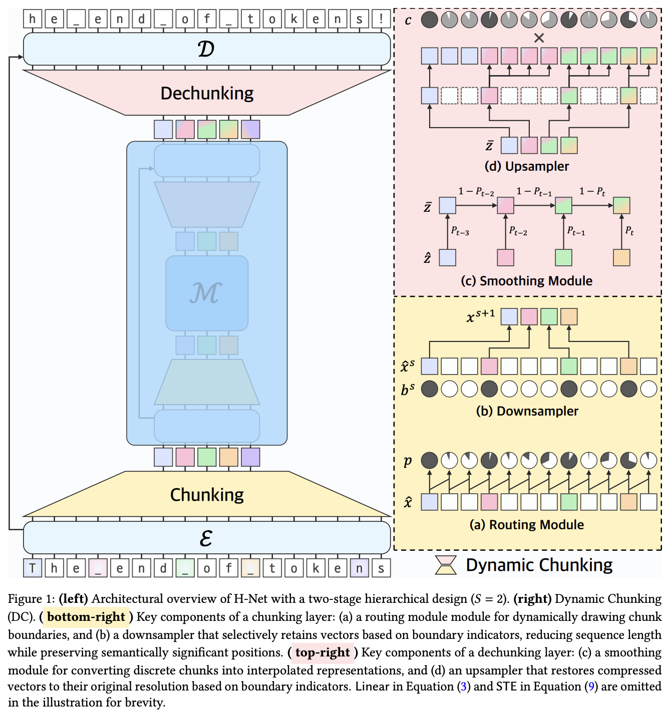

</img>

## H-Net Dynamic Chunking

Implementation of the dynamic chunking mechanism in [H-net](https://arxiv.org/abs/2507.07955) by Hwang et al. of Carnegie Mellon

## Install

```shell
$ pip install h-net-dynamic-chunking
```

## Usage

```python
import torch
from h_net_dynamic_chunking import DynamicSequenceChunker

downsampler = DynamicSequenceChunker(512)

tokens = torch.randn(3, 1024, 512).requires_grad_()

downsampled, upsample_fn, *_ = downsampler(tokens)

assert upsample_fn(downsampled).shape == tokens.shape
```

3 layers hierarchy

```python
import torch
from h_net_dynamic_chunking import DynamicSequenceChunker

downsampler1 = DynamicSequenceChunker(512)
downsampler2 = DynamicSequenceChunker(512)
downsampler3 = DynamicSequenceChunker(512)

tokens = torch.randn(3, 1024, 512).requires_grad_()

downsampled1, upsample_fn1, aux_loss1 = downsampler1(tokens)

# hierarchical network 1 ...

downsampled2, upsample_fn2, aux_loss2 = downsampler2(downsampled1)

# hierarchical network 2 ...

downsampled3, upsample_fn3, aux_loss3 = downsampler3(downsampled2)

# inner most network

# reconstituting

assert upsample_fn1(upsample_fn2(upsample_fn3(downsampled3))).shape == tokens.shape
```

HNet wrapper

```python
import torch
from torch import nn
from h_net_dynamic_chunking.h_net import HNet

# 3 hierarchies, from 512 -> 1024 -> 2048 inner

net = HNet(
    nn.Identity(),
    HNet(
        nn.Identity(),
        HNet(
            nn.Identity(),
            nn.Identity(),
            nn.Identity(),
            dim = 2048
        ),
        nn.Identity(),
        dim = 1024,
        dim_inner = 2048
    ),
    nn.Identity(),
    dim = 512,
    dim_inner = 1024,
)

tokens = torch.randn(1, 1024, 512)

ret = net(tokens)
out, aux_loss = ret.output, ret.loss # (1, 1024, 512), ()
```

## Tokenization

```python
import torch
from torch import nn
from h_net_dynamic_chunking import HNet

dim = 512

net = HNet(
    encoder = nn.Identity(),
    network = HNet(
        encoder = nn.Identity(),
        network = nn.Identity(),
        decoder = nn.Identity(),
        dim = dim
    ),
    decoder = nn.Identity(),
    dim = dim
).eval()

tokens = torch.randn(2, 128, dim)
lens = torch.tensor([128, 96])

with torch.no_grad():
    hierarchy = net.tokenize(tokens, lens = lens)

hierarchy.depth                 # 3 levels, fine -> coarse
hierarchy.finest.embeds         # (2, 128, 512)
hierarchy.coarsest.embeds       # compressed root
hierarchy.coarsest.run_lens     # run lengths back to the level below

hierarchy.repeat_interleave()                  # coarsest -> finest
hierarchy.repeat_interleave(level = 1)         # level 1 -> finest
hierarchy.repeat_interleave_all()              # every level at base resolution
hierarchy.to_rle()                             # coarse -> fine (tokens, run_lens)
```

With vector quantization

```python
net = HNet(
    encoder = nn.Identity(),
    network = HNet(
        encoder = nn.Identity(),
        network = nn.Identity(),
        decoder = nn.Identity(),
        dim = dim,
        vq = dict(dim = dim, codebook_size = 2048)
    ),
    decoder = nn.Identity(),
    dim = dim,
    vq = dict(dim = dim, codebook_size = 2048)
).eval()

with torch.no_grad():
    hierarchy = net.tokenize(tokens, lens = lens)

hierarchy.indices                               # tuple of (batch, level length), -1 for padding
codes = hierarchy.repeat_interleave(use_indices = True)
```

## Example

Enwik8 with 2 hierarchies

```shell
$ pip install '.[examples]'
```

Then

```shell
$ python train.py
```

## Citations

```bibtex
@misc{hwang2025dynamicchunkingendtoendhierarchical,
    title   = {Dynamic Chunking for End-to-End Hierarchical Sequence Modeling},
    author  = {Sukjun Hwang and Brandon Wang and Albert Gu},
    year    = {2025},
    eprint  = {2507.07955},
    archivePrefix = {arXiv},
    primaryClass = {cs.LG},
    url     = {https://arxiv.org/abs/2507.07955},
}
```

```bibtex
@misc{balestriero2025lejepa,
    title   = {LeJEPA: Provable and Scalable Self-Supervised Learning Without the Heuristics},
    author  = {Randall Balestriero and Yann LeCun},
    year    = {2025},
    eprint  = {2511.08544},
    archivePrefix = {arXiv},
    primaryClass = {cs.LG},
    url     = {https://arxiv.org/abs/2511.08544},
}
```

```bibtex
@misc{kim2026hierarchicallatentactionmodel,
    title   = {Hierarchical Latent Action Model},
    author  = {Hanjung Kim and Lerrel Pinto and Seon Joo Kim},
    year    = {2026},
    eprint  = {2603.05815},
    archivePrefix = {arXiv},
    primaryClass = {cs.RO},
    url     = {https://arxiv.org/abs/2603.05815},
}
```

```bibtex
@misc{kumbong2026nextconceptmodeling,
    title   = {Next-Concept Modeling: Fast, Parallel Coarse-to-Fine Text Generation},
    author  = {Hermann Kumbong and Ishan S. Khare and Iddah Mlauzi and Andrew Woen and Charles Ding and E. Kelly Buchanan and Simran Arora and Azalia Mirhoseini and Christopher Ré},
    year    = {2026},
    eprint  = {2610.14162},
    archivePrefix = {arXiv},
    primaryClass = {cs.CL},
    url     = {https://arxiv.org/abs/2610.14162},
}
```
